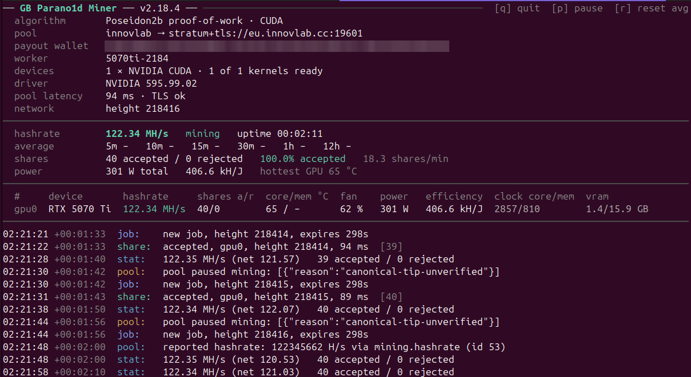
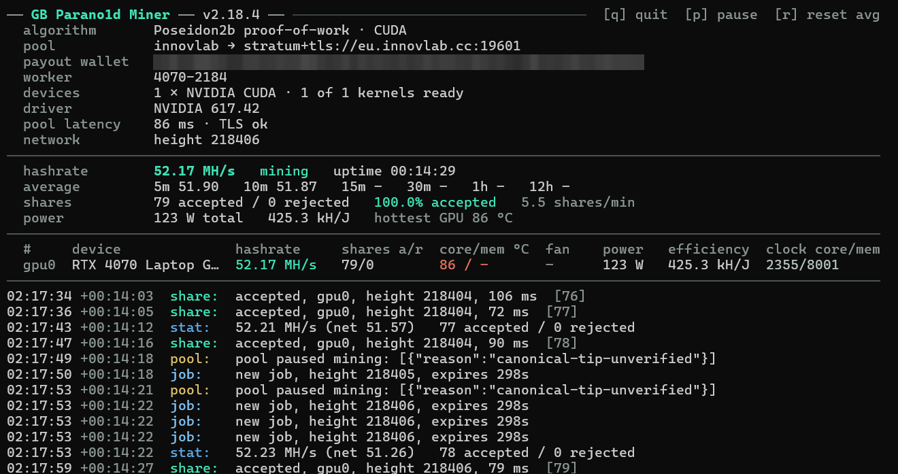

# GB Parano1d Miner

**GB Parano1d Miner** is a GPU miner for the **Parano1d (NOID)** proof-of-work, for NVIDIA RTX 30/40/50-series cards and Hopper (H100) data-center GPUs. Speaks HTTP and Stratum pools natively, runs on Linux, Windows and HiveOS, one download per platform.

Works out of the box with the **InnovLab**, **Suprnova**, **AlphaPool** and **RPlant** pools (`--pool innovlab` / `--pool suprnova` / `--pool alphapool` / `--pool rplant`) and with any other HTTP or Stratum pool by its address.

Built for **hashrate and efficiency**: per-architecture search kernels reach full speed while an automatic low memory-clock lock trims board power (about 13 W on an RTX 5070 Ti) at no cost to the rate, and an adjustable per-GPU power limit lets you set the watts-per-share point you want.

**Current release: v2.18.5**

---

## Download

Grab the archive for your platform from [Releases](../../releases/latest), unpack it, and run it from inside the folder.

| Platform | Archive |
|---|---|
| Linux | `parano1d-miner-2.18.5-linux.tar.gz` |
| Windows | `parano1d-miner-2.18.5-windows.zip` |
| HiveOS | `parano1d-2.18.5.tar.gz` (custom-miner package) |

The Linux and Windows archives carry a `SHA256SUMS` with the SHA-256 of each file inside them, and the `SHA256SUMS` on the release lists all three archives.

No CUDA Toolkit is needed to run — only an NVIDIA driver, version 580 or newer. The Linux and HiveOS binaries run on any 64-bit Linux with glibc 2.31 or newer (Ubuntu 20.04 and later, current HiveOS images).

## Quick start

**Linux** — open `start.sh`, put your payout address after `WALLET=` (and optionally a worker name after `WORKER=`), then run `sh start.sh`. Or pass the full command line:
```
./gb-parano1d-miner cuda-mine --pool innovlab --coinbase <your-o1-address> --worker rig0 --search-binary ./gb-parano1d-engine
```

**Windows** — open `start.bat` in a text editor (right-click → Edit), put your payout address after `WALLET=`, save, and double-click `start.bat`. Or, in PowerShell:
```
./gb-parano1d-miner.exe cuda-mine --pool innovlab --coinbase <your-o1-address> --worker rig0 --search-binary gb-parano1d-engine.exe
```

**HiveOS** — Flight Sheet → Custom miner:
- Miner name: `parano1d`
- Installation URL: `https://github.com/gustlborg/gb-parano1d-miner/releases/download/v2.18.5/parano1d-2.18.5.tar.gz`
- Wallet and worker template: `%WAL%.%WORKER_NAME%` (or your `o1...` address), pool address in the pool field; everything else is optional (see the README inside the package).

HiveOS derives the miner name from the archive's file name, so use exactly this URL and `parano1d`. On HiveOS the rig's OC profile owns the clocks: memory-clock autotune is off there unless you add `AUTOTUNE=on`.

## Pools

`--pool` takes a keyword or a pool address — with its prefix, or a bare host name — and HTTP or Stratum is detected automatically from the address. InnovLab is the default. In `start.sh` / `start.bat`, `POOL` takes either a keyword or a full pool address with its prefix, for example `stratum+tcp://noid.suprnova.cc:3345` for Suprnova SOLO.

| Keyword | Kind |
|---|---|
| `innovlab` | Stratum (default) |
| `suprnova` | Stratum |
| `alphapool` | Stratum (EU endpoint; `stratum+tcp://us1.alphapool.tech:19610` / `sg1…` for other regions) |
| `rplant`, `rplant-na`, `rplant-asia` | Stratum over TLS (EU, North America, Asia) |
| `parano1d` | HTTP |
| `ariabrain` | HTTP |

A second pool can be given with `--backup-pool` / `--backup-rpc`; the miner switches over on its own if the main pool stops answering, and switches back when it returns.

## Hardware

RTX 30/40/50-series and Hopper (H100 — validated on H100 NVL; the H200 uses the same architecture but has not been tested), detected per card, with natively compiled kernels. Workstation and data-center cards with the same chips (for example the RTX A-series, A10/A40, L4/L40 and RTX PRO Blackwell) get the same native kernels; their speed is not measured. Any other NVIDIA GPU with compute capability 8.0 or newer (for example the A100) runs a JIT-compiled fallback kernel (correct, speed not measured; it needs a recent NVIDIA driver, and the miner says so if yours is too old). **RTX 20-series and older are not supported**; in a mixed rig the miner skips such a card with a note and mines on the others. One binary covers all of them, so a rig with mixed generations needs no separate download.

## Measured with efficiency settings

Locked core clock, memory clock and core-clock offset, set with the miner's own options (`LOCK_CORE_CLOCK`, `LOCK_MEM_CLOCK`, `CORE_OFFSET` in `start.sh` / `start.bat`, the same keys on HiveOS). Measured live at the InnovLab pool with this release. kH/W is kilohashes per second per watt. Every card tolerates a different offset; see "Same hashrate, less power" in the package README.

| GPU | Core clock / memory clock / offset | MH/s | Power | kH/W |
|---|---|---|---|---|
| RTX 3060 (Windows) | 1750 MHz / 810 MHz / +200 MHz | 29.52 | 90.1 W | 327.6 |
| RTX 5070 Ti (Linux) | 2705 MHz / 810 MHz / +300 MHz | 117.29 | 186.6 W | 628.6 |

## Multi-GPU

```
--devices 0,1,2
```

By default the miner uses **every supported GPU** — a multi-GPU rig mines all its cards with no extra flag. Each card is driven independently under a single shared pool connection, so the pool sees one worker, not one per card. Pass `--devices 0,1,2` to restrict mining to specific cards (and only those cards are tuned); a list that names an unsupported card stops with a message naming it.

## Autotune

Offered on the first start of a card (asks before measuring; `--autotune on` measures without asking, on HiveOS off unless `AUTOTUNE=on`): the miner measures once per card the lowest memory clock that still delivers the full hashrate and locks it while mining (this proof-of-work needs no memory bandwidth, so that is pure power saving — about 13 W on an RTX 5070 Ti). The lock is removed when the miner exits. Needs passwordless `nvidia-smi` on Linux or Administrator rights on Windows; without them the miner says so and mines on at default clocks.

## Power limit

New in 2.17.0. `--powerlimit 270` sets the board power limit of every selected card to 270 W before mining and puts the previous limit back when the miner exits, Ctrl+C included. `270w` works too, and on multi-GPU rigs a comma list gives each `--devices` entry its own value:

```
--devices 0,1 --powerlimit 270,150
```

The miner reads each card's allowed range first and refuses to start with a value outside it. Measured on the release kernels, the last 5 % of board power buy only about 1 % of hashrate, so this is an efficiency setting — fewer watts per share, cooler and quieter cards — not a speed knob. The README in each package lists NVIDIA's reference board power for every supported model from the RTX 3060 to the RTX 5090 with a starting point for efficient mining. On HiveOS the same setting is `POWER_LIMIT=270` in the flight sheet's custom user config.

## Efficiency modes

`--efficiency mode1` or `--efficiency mode2` (in `start.sh` / `start.bat`: `EFFICIENCY=mode1`; on HiveOS `EFFICIENCY=mode1` in the custom user config) runs a kernel variant that gives up some hashrate for noticeably fewer watts per hash: mode 1 trades the least hashrate, mode 2 saves the most power. Off unless you set it.

The modes save power whenever the card is not held back by its power limit: with a locked core clock (`--lock-core-clock` or an OC profile), or when it already reaches its top clock below the limit, like the RTX 5070 Ti below at stock settings. A card that runs into its power limit, like the RTX 3060 at stock settings, turns the saved power into clock instead, so there a mode only costs hashrate at the same power: leave it off. Measured live at the InnovLab pool, two runs of 2 minutes per setting, memory clock 810 MHz with the lock, standard memory clock at stock:

| Card | Core clock | Mode | MH/s | Power | kH/W |
|---|---|---|---|---|---|
| RTX 3060 | locked at 1750 MHz | standard | 29.6 | 123 W | 240 |
| RTX 3060 | locked at 1750 MHz | mode 1 | 29.2 | 120 W | 243 |
| RTX 3060 | locked at 1750 MHz | mode 2 | 27.6 | 105 W | 263 |
| RTX 3060 | stock (170 W limit) | standard | 30.6 | 170 W | 180 |
| RTX 3060 | stock (170 W limit) | mode 1 | 30.4 | 170 W | 179 |
| RTX 3060 | stock (170 W limit) | mode 2 | 29.5 | 169 W | 174 |
| RTX 4060 Ti | locked at 2400 MHz | standard | 50.4 | 118 W | 426 |
| RTX 4060 Ti | locked at 2400 MHz | mode 1 | 49.8 | 115 W | 434 |
| RTX 4060 Ti | locked at 2400 MHz | mode 2 | 48.0 | 103 W | 466 |
| RTX 5070 Ti | locked at 2600 MHz | standard | 112.7 | 208 W | 542 |
| RTX 5070 Ti | locked at 2600 MHz | mode 1 | 111.8 | 202 W | 552 |
| RTX 5070 Ti | locked at 2600 MHz | mode 2 | 106.9 | 183 W | 585 |
| RTX 5070 Ti | stock (320 W limit) | standard | 124.5 | 307 W | 405 |
| RTX 5070 Ti | stock (320 W limit) | mode 1 | 123.4 | 301 W | 410 |
| RTX 5070 Ti | stock (320 W limit) | mode 2 | 118.0 | 269 W | 438 |

Efficiency modes exist for RTX 30, RTX 40 and RTX 50 cards. Other GPUs (H100, and cards on the JIT fallback) keep the standard kernel and the start line says so. A mode works together with a core-clock offset (see "Same hashrate, less power" in the package README).

## Developer fee

This miner mines a disclosed **3 % developer fee** into a separate wallet, interleaved continuously rather than taken as one long block, so the pool never sees either session go idle. The fee has no log lines of its own, its shares are not counted in the miner's share totals (the hashrate shown is the card's full rate), and the fee wallet is never displayed — the README is the disclosure.

## Dashboard

In a terminal window the miner shows a live dashboard: pool, wallet, worker, driver, pool latency and block height at the top; hashrate with rolling averages, shares, power and efficiency below; one row per GPU (hashrate, shares, temperatures, fan, power, efficiency, clocks, VRAM) above the scrolling log. It adapts to the window size. Keys: `q` quits cleanly (like Ctrl+C), `p` pauses and resumes mining, `r` resets the hashrate averages, `PgUp`/`PgDn` (or the arrow keys) page back through the log and `End` returns to the live log.





Output that is redirected — HiveOS, a log file, a pipe — stays a plain log. The dashboard copies out of a terminal as merged lines; set `PARANO1D_PLAIN_OUTPUT=1` for a plain, append-only log that pastes cleanly into a bug report.

## What's new in 2.18.5

- **Faster kernels, newly tuned per GPU generation.** Measured against 2.18.4 on the same card: RTX 5070 Ti and RTX 3060 +1.6 % at locked clocks, RTX 5090 (at its 575 W limit) and H100 NVL (400 W limit) +0.9 %, RTX 4090 (370 W cap) +0.7 %.
- **Same hashrate, less power, set by the miner:** `--core-clock-offset` / `--mem-clock-offset` and named fields in `start.sh` / `start.bat` (`LOCK_CORE_CLOCK`, `LOCK_MEM_CLOCK`, `CORE_OFFSET`, `MEM_OFFSET`, `POWER_LIMIT`; HiveOS: `CORE_OFFSET`, `MEM_OFFSET`) — no OC tool needed, previous values are put back at exit. RTX 3060 with core-clock lock + offset (measured on Windows): 77 % more hashes per watt than at stock, 91 % together with mode 2. Measured profiles in the package READMEs.
- **Efficiency modes:** `--efficiency mode1` / `mode2` — fewer watts per hash for a little hashrate on cards that are not held back by their power limit, see [Efficiency modes](#efficiency-modes).
- **Less CPU load on Linux and HiveOS:** about 5 % of one CPU core per GPU instead of 100 %, at the same hashrate.
- **Steadier pool connection:** after a drop the miner dials the pool again after a quarter of a second (before: a fixed 3 s pause), and a single unanswered share no longer resets a working connection.
- **A wrong hash from the GPU is reported** in the log with its GPU, so an unstable overclock or undervolt does not go unnoticed.
- **More pools by name:** `alphapool`, `rplant`, `rplant-na` and `rplant-asia`; `--pool` also takes a pool address, with its prefix or as a bare host name.
- **Page back through the log** in the dashboard, and `--log-file <path>` keeps a plain copy of the log.
- **Too old an NVIDIA driver is named plainly** at start (580 or newer is needed) instead of an engine error.
- Autotune now keeps the full hashrate, Ctrl+C stops the miner in order, and `PARANO1D_ASCII=1` gives plain ASCII output.

### 2.18.4

- **Faster GPU kernels** for RTX 30, RTX 40 and RTX 50 series cards (about 9–13 % more hashrate than 2.18.2), and a much faster kernel for Hopper (H100).
- **Live dashboard** with per-GPU rows and the keys `q` (quit), `p` (pause/resume) and `r` (reset averages); Ctrl+C, Ctrl+Z and resizing the window leave the terminal intact.
- **Easier first start:** set your wallet once in `start.sh` (Linux, run `sh start.sh`) or `start.bat` (Windows, double-click).
- **Accepted shares are logged with the GPU that found them**, and rejected shares name their GPU too.
- **Smaller download** — the engine files are more than a third smaller.
- **Keep the files of one release together:** a mix of files from different releases is refused at start with a message saying so.
- **Clearer connection errors**, e.g. `cannot connect to <host>:<port> (connection timed out)`.
- **One licence file:** `LICENSE` now also carries all third-party licence texts.

### 2.18.2

- **Hopper (H100) support.** A native kernel for NVIDIA Hopper (compute capability 9.0), validated on H100 NVL, single- and multi-GPU. The H200 uses the same architecture but has not been tested yet. RTX 30/40/50 behaviour and hashrate are unchanged.
- **Robustness and integrity hardening** under the hood; nothing changes in how you install or run the miner.

### 2.17.9

- **Your clock settings stay yours.** The miner only releases a core-clock lock it set itself; a lock from a HiveOS OC profile, Afterburner or `nvidia-smi -lgc` is left alone. A lock left by 2.17.8 or older: reboot once or run `nvidia-smi -rgc`.
- **HiveOS: OC profile in charge, standard paths.** Autotune is off by default on HiveOS (`AUTOTUNE=on` enables it), config and log sit where HiveOS expects them (`miner log` readable, copy in `/var/log/miner/custom/parano1d.log`).
- **Mixed rigs with RTX 20-series cards start.** Unsupported cards are skipped with a note instead of stopping the whole start; HiveOS passes only supported cards.
- **Clean stop, settings always restored** — power limit and clock locks are put back on every exit: engine crash, Ctrl+C pressed twice, a closed terminal or console window. Ctrl+C now says "stopping … please wait".
- **Autotune asks first.** Without a saved result the miner asks before measuring a card (about 2½ minutes, once; Enter = yes) and reminds you to keep the GPU free; a saved result is simply used; `--autotune on` measures without asking, `--autotune off` skips it. Missing Administrator/root rights are reported with a question whether to mine anyway at normal clocks, so they cannot go unnoticed.
- **Honest tuning messages** — a setting the card does not support (e.g. memory-clock locks on many laptop GPUs) is reported as such instead of "applied".

### 2.17.8

- **All GPUs by default.** A multi-GPU rig mines on every visible card without `--devices`; the flag now selects a subset. Clock/power tuning stays off on cards you did not select.
- **Core-clock lock managed for you.** `--lock-core-clock` no longer leaves a card throttled after the miner stops — the lock is released at a clean exit, and a stale lock is cleared on the next start without the flag.
- **HiveOS out of the box.** The custom-miner package installs and starts cleanly (the install/run scripts and the `parano1d/` folder are fixed), and the Linux/HiveOS binaries run on current HiveOS images and Ubuntu 20.04/22.04 (glibc 2.31).
- **Robust Windows Stratum start**, and **backup-pool failover** on a stuck pool: a sustained `mining.pause` (a pool that keeps the connection but stops sending work) switches to `--backup-pool`, and back when the main pool returns.

### 2.17.6

- Share quality: the miner keeps searching your work when a pool or fee connection stumbles instead of going idle, so more of what the GPU computes lands as accepted work. The disclosed 3 % fee stays exact — deferred and repaid, never dropped.
- Efficiency: new `--lock-core-clock <MHz>` settles each card at its best hashes-per-watt point, alongside `--powerlimit` and memory-clock autotune.
- Refined native per-architecture kernels (RTX 30 / 40 / 50): a further, small raw-rate improvement over 2.17.0.

### 2.17.0

- Power-limit mode: `--powerlimit <W>` (also `270w`, one value or one per GPU), range-checked against the card, restored at exit; HiveOS `POWER_LIMIT=`.
- Per-model board-power table (RTX 3060 … RTX 5090, Ti and Super models included) with efficient starting points in every README.

### 2.15.0

- Developer fee lowered to 3 %.
- Faster per-architecture kernels on RTX 30/40/50, tuned for efficiency: the autotuned low memory clock holds full speed while trimming board power (about 15 W on an RTX 5070 Ti).
- HTTP pools: no more duplicate-share rejections when the pool re-issues a template at the same height.
- Autotune on by default, with a memory-clock calibration per card that is cached next to the binary.
- Full HiveOS integration: per-GPU temperature, fan and bus data on the dashboard, `%WAL%`/`%WORKER_NAME%` placeholders, wallet.worker form.
- JIT fallback kernel for other NVIDIA GPUs with compute capability 8.0+ (needs a recent NVIDIA driver; the miner says so if yours is too old).

## License

The GB Parano1d Miner is proprietary software, distributed as a binary release — see `LICENSE`. Reverse engineering, decompilation, disassembly, and analysis by any automated system (including large language models) are prohibited under that license, except where such a prohibition is void under applicable mandatory law. Third-party components and their licenses are listed at the end of the same file.
