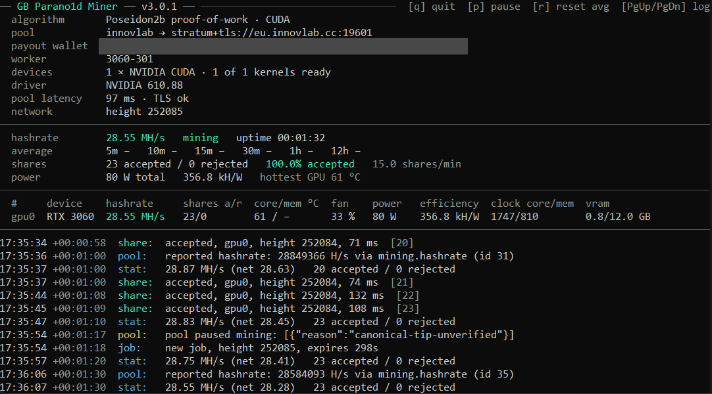

# GB Parano1d Miner



**GB Parano1d Miner** is a GPU miner for the **Parano1d (NOID)** proof-of-work, for NVIDIA RTX 30/40/50-series cards, Hopper (H100) and GA100 (CMP 170HX, A100, A30). Speaks HTTP and Stratum pools natively, runs on Linux, Windows and HiveOS, one download per platform.

Works out of the box with the **InnovLab**, **Suprnova**, **AlphaPool** and **RPlant** pools (`--pool innovlab` / `--pool suprnova` / `--pool alphapool` / `--pool rplant`) and with any other HTTP or Stratum pool by its address.

Built for **hashrate and efficiency**: per-architecture search kernels reach full speed while an automatic low memory-clock lock trims board power (about 13 W on an RTX 5070 Ti) at no cost to the rate, and an adjustable per-GPU power limit lets you set the watts-per-share point you want.

**Current release: v3.0.5**

- **About +50 % on GA100 and Hopper cards.** New arithmetic for the CMP 170HX, A100, A30 and H100, measured live at the InnovLab pool against 3.0.2 on rented servers at stock settings: CMP 170HX +47.5 % (190.1 → 280.3 MH/s at practically the same power, +1 %), A100 SXM4 +54.6 % (251.4 → 388.7 MH/s), H100 NVL +50.1 % (385.3 → 578.3 MH/s at its 400 W limit). In our tests on 27–28 October 2026 this was the highest hashrate on these three cards against every other NOID miner that ran on them (six on the CMP 170HX and the A100, five on the H100 NVL), at stock settings.
- **RTX 30 and RTX 40 faster in every mode.** New kernels, measured live against 3.0.2 at the same locked clocks and core-clock offset: RTX 4060 Ti +1.55 % in `performance`, +1.67 % in `balanced` and +1.35 % in `efficiency`, with 1.8–3.5 % more hashes per watt; RTX 3060 (Windows) +3.73 %, +1.30 % and +1.33 %. On RTX 30 cards `performance` now uses more of the card: at a locked clock it draws about 8 % more power for its 3.7 % (choose `balanced` for the best hashes per watt); at the stock 170 W power limit the RTX 3060 gains 1.7 % in `performance` at the same power.
- RTX 50 (Blackwell) runs the same kernels as in 3.0.2 (RTX 5070 Ti measured unchanged within ±0.03 %).
- Everything from 3.0.2 stays: the native GA100 kernel, the lower CPU load of the engine, three mining modes with `balanced` as the default, and a developer fee of 2 %.

**Since 3.0.2:**

- **New native kernel for GA100 cards (CMP 170HX, A100, A30): about 2.5× the hashrate on the CMP 170HX and the A100.** These cards (compute capability 8.0) ran the portable JIT fallback until now. 3.0.2 brings a kernel built for them, measured live at the InnovLab pool: CMP 170HX 164.8 MH/s per card at 198 W (power limit 200 W, set by the rig's host), A100 SXM4 251.4 MH/s at about 270–295 W (power limit 400 W, not reached). In v3.0.1 these cards reached 64.0 MH/s (CMP 170HX) and about 99 MH/s (A100). Like every other supported card it now runs with NVIDIA driver 580 or newer; the fallback needed a driver with CUDA 13.3 support, so on older drivers these cards did not start at all.
- **Less CPU load on every GPU.** At the end of each batch the engine now waits only as long as the card and the host need: on an otherwise idle host about 1–2 % of one CPU core per GPU instead of about 5 % (RTX 3060 under Windows 1.0–1.5 %, RTX 5070 Ti 1.7–2.2 %, A100 0.9 %), with the GPU kept as busy as before (the time it waits for the host between batches unchanged within ±0.01 %). On a busy host it keeps a larger margin by itself.

**Since 3.0.1:**

- **CPU load fixed.** While the GPUs work, the miner needs only about 5 % of one CPU core per GPU instead of a full core — new on Windows, on Linux and HiveOS since 2.18.5. Tested out of the box on rented rigs: three GPUs on a two-thread CPU use 8 % of it. (3.0.2 lowers it further, see above.)
- **The fastest and most efficient NOID miner in our tests.** `performance` mode showed the highest hashrate (before developer fees) and `efficiency` mode the most hashes per watt against eight other NOID miners for Stratum pools built for RTX 30/40/50 cards, on an RTX 4060 Ti and an RTX 5070 Ti under Linux, and against the six of them that ran on an RTX 3060 under Windows. Every miner ran at the same locked core clock with offset (the clocks in the table below), the other miners with their default options and in the versions current when we tested them (24–25 October 2026).
- **Three mining modes.** `performance` for the highest hashrate (up to +1.3 % over 2.18.5, on RTX 40); `balanced`, the new default, gives up about 1–4 % hashrate for up to about 8 % more hashes per watt; `efficiency` gives up about 5.5–9 % hashrate for up to about 15 % more hashes per watt (both compared with `performance` at a locked core clock with offset; see [Mining modes](#mining-modes)).
- **Developer fee lowered to 2 %** (was 3 %).

---

## Download

Grab the archive for your platform from [Releases](../../releases/latest), unpack it, and run it from inside the folder.

| Platform | Archive |
|---|---|
| Linux | `parano1d-miner-3.0.5-linux.tar.gz` |
| Windows | `parano1d-miner-3.0.5-windows.zip` |
| HiveOS | `parano1d-3.0.5.tar.gz` (custom-miner package) |

The Linux and Windows archives carry a `SHA256SUMS` with the SHA-256 of each file inside them, and the `SHA256SUMS` on the release lists all three archives.

No CUDA Toolkit is needed to run — only an NVIDIA driver, version 580 or newer. The Linux and HiveOS binaries run on any 64-bit Linux with glibc 2.31 or newer (Ubuntu 20.04 and later, current HiveOS images).

## Quick start

**Linux and Windows** — open the start script in a text editor (`start.sh`; on Windows right-click `start.bat` → Edit), fill in the block at the top, save, and start it:

| Field | What to put in |
|---|---|
| `WALLET` | your `o1…` payout address (required) |
| `WORKER` | name shown on the pool (optional; blank = the computer's name) |
| `POOL` | `innovlab` (default), `suprnova`, `alphapool`, `rplant`, `parano1d`, `ariabrain`, or a pool address such as `stratum+tcp://noid.suprnova.cc:3345` |
| `MODE` | optional: `balanced` (default), `performance` (highest hashrate) or `efficiency` (fewest watts per hash) |
| `LOCK_CORE_CLOCK`, `LOCK_MEM_CLOCK`, `CORE_OFFSET`, `POWER_LIMIT` | optional OC profile, e.g. `2705`, `810`, `300` on an RTX 5070 Ti (see [Measured with efficiency settings](#measured-with-efficiency-settings)); blank leaves the card alone. Set at start, put back when the miner exits |

In `start.bat` each line reads `set "FIELD=value"`, for example `set "WALLET=o1abc..."`. Start it with `sh start.sh` on Linux (with clock or power settings as root: `sudo sh start.sh`) or by double-clicking `start.bat` on Windows (with clock or power settings: right-click → Run as administrator).

**Linux** — or pass the full command line:
```
./gb-parano1d-miner cuda-mine --pool innovlab --coinbase <your-o1-address> --worker rig0 --search-binary ./gb-parano1d-engine
```

**Windows** — or, in PowerShell:
```
./gb-parano1d-miner.exe cuda-mine --pool innovlab --coinbase <your-o1-address> --worker rig0 --search-binary gb-parano1d-engine.exe
```

**HiveOS** — Flight Sheet → Custom miner:
- Miner name: `parano1d`
- Installation URL: `https://github.com/gustlborg/gb-parano1d-miner/releases/download/v3.0.5/parano1d-3.0.5.tar.gz`
- Wallet and worker template: `%WAL%.%WORKER_NAME%` (or your `o1...` address), pool address in the pool field; everything else is optional, for example `MODE=performance` or `LOCK_CORE_CLOCK=`, `LOCK_MEM_CLOCK=`, `CORE_OFFSET=` in the custom user config (see the README inside the package).

HiveOS derives the miner name from the archive's file name, so use exactly this URL and `parano1d`. On HiveOS the rig's OC profile owns the clocks: memory-clock autotune is off there unless you add `AUTOTUNE=on`.

## Pools

`--pool` takes a keyword or a pool address — with its prefix, or a bare host name — and HTTP or Stratum is detected automatically from the address. InnovLab is the default. In `start.sh` / `start.bat`, `POOL` takes either a keyword or a full pool address with its prefix, for example `stratum+tcp://noid.suprnova.cc:3345` for Suprnova SOLO.

| Keyword | Kind |
|---|---|
| `innovlab` | Stratum (default) |
| `suprnova` | Stratum |
| `alphapool` | Stratum (EU endpoint; `stratum+tcp://us1.alphapool.tech:19610` / `sg1…` for other regions) |
| `rplant`, `rplant-na`, `rplant-asia` | Stratum over TLS (EU, North America, Asia) |
| `parano1d` | HTTP |
| `ariabrain` | HTTP |

A second pool can be given with `--backup-pool` / `--backup-rpc`; the miner switches over on its own if the main pool stops answering, and switches back when it returns.

## Hardware

RTX 30/40/50-series, Hopper (H100 — validated on H100 NVL; the H200 uses the same architecture but has not been tested) and GA100 (validated on the CMP 170HX and the A100 SXM4; the A30 uses the same chip but has not been tested), detected per card, with natively compiled kernels. Workstation and data-center cards with the same chips (for example the RTX A-series, A10/A40, L4/L40 and RTX PRO Blackwell) get the same native kernels; their speed is not measured. Any other NVIDIA GPU with compute capability 8.0 or newer (for example data-center Blackwell such as the B200) runs a JIT-compiled fallback kernel (correct, speed not measured; it needs a driver with CUDA 13.3 support or newer, and the miner says so if yours is too old). **RTX 20-series and older are not supported**; in a mixed rig the miner skips such a card with a note and mines on the others. One binary covers all of them, so a rig with mixed generations needs no separate download.

## Measured with efficiency settings

Locked core clock, memory clock and core-clock offset, set from outside the miner through the NVIDIA driver; the miner's own options (`LOCK_CORE_CLOCK`, `LOCK_MEM_CLOCK`, `CORE_OFFSET` in `start.sh` / `start.bat`, the same keys on HiveOS) do the same, the power can then differ by several percent. Measured live at the InnovLab pool with 3.0.5 on 28 October 2026, two 1-minute runs per mode (mean shown). Displayed hashrate, board power from nvidia-smi; kH/W is kilohashes per second per watt. Every card tolerates a different offset; see "Same hashrate, less power" in the package README.

| GPU | Mode | Core clock / memory clock / offset | MH/s | Power | kH/W |
|---|---|---|---|---|---|
| RTX 3060 (Windows) | performance | 1750 MHz / 810 MHz / +200 MHz | 30.83 | 102.1 W | 302.0 |
| RTX 3060 (Windows) | balanced | 1750 MHz / 810 MHz / +200 MHz | 29.55 | 90.7 W | 325.8 |
| RTX 3060 (Windows) | efficiency | 1750 MHz / 810 MHz / +200 MHz | 28.16 | 81.2 W | 346.8 |
| RTX 4060 Ti (Linux) | performance | 2450 MHz / 810 MHz / +250 MHz | 53.10 | 106.4 W | 499.1 |
| RTX 4060 Ti (Linux) | balanced | 2450 MHz / 810 MHz / +250 MHz | 52.66 | 103.3 W | 509.8 |
| RTX 4060 Ti (Linux) | efficiency | 2450 MHz / 810 MHz / +250 MHz | 49.76 | 89.5 W | 555.7 |
| RTX 5070 Ti (Linux) | performance | 2705 MHz / 810 MHz / +300 MHz | 117.72 | 206.3 W | 570.7 |
| RTX 5070 Ti (Linux) | balanced | 2705 MHz / 810 MHz / +300 MHz | 116.77 | 199.5 W | 585.2 |
| RTX 5070 Ti (Linux) | efficiency | 2705 MHz / 810 MHz / +300 MHz | 111.29 | 180.9 W | 615.1 |

### GA100 and Hopper cards (rented servers)

On rented servers the host sets the clocks and the power limit, so no OC profile could be applied: these cards ran at the host's settings (its power limit, default clocks), and only the hashrate is shown. They have no mining modes; each runs its one kernel. Measured live at the InnovLab pool with 3.0.5 on 28 October 2026, mean of two 2-minute runs.

| GPU | Power limit | MH/s |
|---|---|---|
| CMP 170HX | 200 W (set by the host; the card's default is 250 W) | 280.3 |
| A100 SXM4 40GB | 400 W (the card's default) | 388.7 |
| H100 NVL | 400 W (set by the host; the card's default is 310 W) | 578.3 |

## Multi-GPU

```
--devices 0,1,2
```

By default the miner uses **every supported GPU** — a multi-GPU rig mines all its cards with no extra flag. Each card is driven independently under a single shared pool connection, so the pool sees one worker, not one per card. Pass `--devices 0,1,2` to restrict mining to specific cards (and only those cards are tuned); a list that names an unsupported card stops with a message naming it.

## Autotune

Offered on the first start of a card (asks before measuring; `--autotune on` measures without asking, on HiveOS off unless `AUTOTUNE=on`): the miner measures once per card the lowest memory clock that still delivers the full hashrate and locks it while mining (this proof-of-work needs no memory bandwidth, so that is pure power saving — about 13 W on an RTX 5070 Ti). The lock is removed when the miner exits. Needs passwordless `nvidia-smi` on Linux or Administrator rights on Windows; without them the miner says so and mines on at default clocks.

## Power limit

New in 2.17.0. `--powerlimit 270` sets the board power limit of every selected card to 270 W before mining and puts the previous limit back when the miner exits, Ctrl+C included. `270w` works too, and on multi-GPU rigs a comma list gives each `--devices` entry its own value:

```
--devices 0,1 --powerlimit 270,150
```

The miner reads each card's allowed range first and refuses to start with a value outside it. Measured on the release kernels, the last 5 % of board power buy only about 1 % of hashrate, so this is an efficiency setting — fewer watts per share, cooler and quieter cards — not a speed knob. The README in each package lists NVIDIA's reference board power for every supported model from the RTX 3060 to the RTX 5090 with a starting point for efficient mining. On HiveOS the same setting is `POWER_LIMIT=270` in the flight sheet's custom user config.

## Mining modes

`--mode performance|balanced|efficiency` (in `start.sh` / `start.bat`: `MODE=balanced`; on HiveOS `MODE=` in the custom user config) sets how the miner trades hashrate against power. Without the option the miner runs **balanced**:

- **performance** — the highest hashrate.
- **balanced** (default) — a little less hashrate for fewer watts per hash.
- **efficiency** — the fewest watts per hash, at a lower hashrate.

Balanced and efficiency save power whenever the card is not held back by its power limit: with a locked core clock (`--lock-core-clock` or an OC profile), with or without a core-clock offset, or when it already reaches its top clock below the limit, like an RTX 5070 Ti at stock settings. At a locked core clock, balanced gives up about 1–2 % hashrate for 2–6 % less power (about 3–11 % with an offset), and efficiency 5.5–9 % hashrate for 14–16 % less power (12–20 % with an offset), measured on an RTX 3060, RTX 4060 Ti and RTX 5070 Ti. A card that runs into its power limit, like an RTX 3060 or RTX 4060 Ti at stock settings, turns the saved power into clock instead: there balanced saves no power and is 0.2–0.9 % slower than performance (`--mode performance` gives that back), and efficiency gives up 3–4 %. At a lowered power limit all three modes draw the same power; balanced is as fast as performance (RTX 4060 Ti +0.4 %, RTX 5070 Ti +0.5 %, RTX 3060 −0.1 %) and efficiency only costs hashrate (−1 to −2.5 %), so it is not the mode for a card held at its power limit. A locked core clock plus a core-clock offset (see "Same hashrate, less power" in the package README) gives the biggest saving, in any mode. The README inside each package lists the numbers measured per card.

Modes exist for RTX 30, RTX 40 and RTX 50 cards. Other GPUs (H100, the GA100 cards A100, A30 and CMP 170HX, and cards on the JIT fallback) run their one kernel, and the card's line in the log says so.

## Developer fee

This miner mines a disclosed **2 % developer fee** into a separate wallet, interleaved continuously rather than taken as one long block, so the pool never sees either session go idle. The fee has no log lines of its own, its shares are not counted in the miner's share totals (the hashrate shown is the card's full rate), and the fee wallet is never displayed — the README is the disclosure.

## Dashboard

In a terminal window the miner shows a live dashboard: pool, wallet, worker, driver, pool latency and block height at the top; hashrate with rolling averages, shares, power and efficiency below; one row per GPU (hashrate, shares, temperatures, fan, power, efficiency, clocks, VRAM) above the scrolling log. It adapts to the window size. Keys: `q` quits cleanly (like Ctrl+C), `p` pauses and resumes mining, `r` resets the hashrate averages, `PgUp`/`PgDn` (or the arrow keys) page back through the log and `End` returns to the live log.

Output that is redirected — HiveOS, a log file, a pipe — stays a plain log. The dashboard copies out of a terminal as merged lines; set `PARANO1D_PLAIN_OUTPUT=1` for a plain, append-only log that pastes cleanly into a bug report.

## What's new in 3.0.5

Compared with 3.0.2:

- **New arithmetic for GA100 (CMP 170HX, A100, A30) and Hopper (H100) cards.** Measured live at the InnovLab pool on 28 October 2026 on rented servers, stock settings (the host's power limit, default clocks), 3.0.2 and 3.0.5 taking turns, two-minute runs, the mean of two runs for 3.0.5:

| GPU | 3.0.2 | 3.0.5 | Hashrate | Power | kH/W |
|---|---|---|---|---|---|
| CMP 170HX | 190.1 MH/s at 197 W | 280.3 MH/s at 199 W | +47.49 % | +1.07 % | +45.93 % |
| A100 SXM4 40GB | 251.4 MH/s at 274 W | 388.7 MH/s at 338 W | +54.61 % | +23.31 % | +25.39 % |
| H100 NVL | 385.3 MH/s at 375 W | 578.3 MH/s at 398 W | +50.10 % | +6.23 % | +41.30 % |

The A30 uses the same chip as the A100 but has not been tested. On power-limited cards (the CMP 170HX at its 200 W host limit, the H100 NVL at 400 W) the extra rate comes at the same power; the A100, below its limit, draws more power for it and still gains 25 % hashes per watt.

- **New kernels for RTX 30 and RTX 40 cards, in all three modes.** Measured live at the InnovLab pool on 28 October 2026 with the release packages of 3.0.2 and 3.0.5 taking turns, two 1-minute runs per mode and version, the same OC profile for both (see [Measured with efficiency settings](#measured-with-efficiency-settings)), no invalid shares:

| GPU | Mode | 3.0.2 | 3.0.5 | Hashrate | Power | kH/W |
|---|---|---|---|---|---|---|
| RTX 4060 Ti (Linux) | performance | 52.29 MH/s | 53.10 MH/s | +1.55 % | −0.34 % | +1.89 % |
| RTX 4060 Ti (Linux) | balanced | 51.80 MH/s | 52.66 MH/s | +1.67 % | −0.12 % | +1.79 % |
| RTX 4060 Ti (Linux) | efficiency | 49.10 MH/s | 49.76 MH/s | +1.35 % | −2.10 % | +3.53 % |
| RTX 3060 (Windows) | performance | 29.72 MH/s | 30.83 MH/s | +3.73 % | +7.84 % | −3.80 % |
| RTX 3060 (Windows) | balanced | 29.18 MH/s | 29.55 MH/s | +1.30 % | +0.41 % | +0.89 % |
| RTX 3060 (Windows) | efficiency | 27.79 MH/s | 28.16 MH/s | +1.33 % | −1.56 % | +2.93 % |
| RTX 5070 Ti (Linux) | performance | 117.71 MH/s | 117.72 MH/s | +0.01 % | −0.16 % | +0.17 % |
| RTX 5070 Ti (Linux) | balanced | 116.74 MH/s | 116.77 MH/s | +0.03 % | +0.02 % | ±0.00 % |
| RTX 5070 Ti (Linux) | efficiency | 111.29 MH/s | 111.29 MH/s | ±0.00 % | +0.09 % | −0.09 % |

The RTX 5070 Ti runs the same kernel in both versions; its rows show the spread of such a measurement. Workstation and data-center cards with RTX 30 or RTX 40 chips get the same new kernels; their speed is not measured.

### 3.0.2

Compared with 3.0.1:

- **New native GA100 kernel for the CMP 170HX, A100 and A30.** A kernel built and tuned for this chip instead of the portable fallback. Measured on four CMP 170HX with a 200 W power limit set by the rig's host: 164.8 MH/s per card at 198 W (833 kH/W) against 64.0 MH/s with the fallback (+157 %); on an A100 SXM4 40 GB with its 400 W power limit, which it did not reach: 251.4 MH/s at 272 W with the card below 60 °C (923 kH/W) and at 292–294 W at about 73 °C. GA100 cards run this one kernel; the mining modes are for RTX 30/40/50. Runs with NVIDIA driver 580 or newer. The A30 uses the same chip but has not been tested.
- **Less CPU load on every GPU.** The engine's active wait at the end of each batch now adapts to the card and the host: about 1–2 % of one CPU core per GPU on an otherwise idle host instead of about 5 %, measured on an RTX 3060 (Windows) and an RTX 5070 Ti (Linux) with and without a locked core clock, and on an A100. The time the GPU waits for the host between batches stayed the same within ±0.01 % (on an RTX 4060 Ti next to other work it did not increase). On a busy host the wait stays closer to the old one (an RTX 4060 Ti next to other work: 4.6 %; four CMP 170HX on a four-thread CPU: 3.1–4.3 % per GPU).

### 3.0.1

Compared with 2.18.5:

- **New mining modes, and a new default.** `--mode performance|balanced|efficiency` (`MODE=` in `start.sh`, `start.bat` and the HiveOS custom user config), see [Mining modes](#mining-modes). Without an option the miner now runs **balanced**; 2.18.5 ran what is now called `performance`. At a locked core clock (with or without a core-clock offset), balanced gives up about 1–2 % hashrate for 2–6 % less power (about 3–4 % with an offset), and at the stock power limit of an RTX 3060 or RTX 4060 Ti the card turns the saved watts into clock, so balanced saves no power there and is 0.2–0.9 % slower. `--mode performance` (`MODE=performance`) gives the 2.18.5 behaviour back. The 2.18.5 option `--efficiency mode1|mode2` still works, and so does `EFFICIENCY=` on HiveOS.
- **Developer fee lowered to 2 %** (was 3 %).
- **Faster on RTX 40 in performance mode.** A retuned kernel for RTX 40-series cards: +1.3 % hashrate on an RTX 4060 Ti at a locked core clock, for about 2 % more power, and +0.4 % at stock clocks, where the card sits at its power limit (both against 2.18.5). Also in performance mode, the RTX 30 kernel is on par (+0.1 % hashrate at 0.8 % less power on an RTX 3060, same session) and the RTX 50 kernel is unchanged.
- **Balanced and efficiency retuned on all three generations.** Compared with performance at a locked core clock, balanced gives up about 1–2 % hashrate for 2–6 % less power: RTX 4060 Ti −0.9 % hashrate and −3.0 % power, RTX 5070 Ti −0.8 % and −2.2 %, RTX 3060 −1.9 % and −6.0 %. Efficiency saves the most: −6 to −6.5 % hashrate for −15 to −16 % power on RTX 30 and RTX 40, −5.5 % and −14 % on RTX 50. These savings need a card that is not held at its power limit. At a lowered power limit balanced is as fast as performance (RTX 4060 Ti +0.4 %, RTX 5070 Ti +0.5 %, RTX 3060 −0.1 % at the same watts), while efficiency only costs hashrate there (−1 to −2.5 % at the same watts). The READMEs list the measured numbers per card, locked, at a lowered power limit and at stock settings.
- **Less CPU load on Windows too.** While the GPU works, its engine no longer keeps a CPU core busy on Windows either: about 5 % of one core per GPU instead of 100 %, at the same hashrate (measured on an RTX 3060).

### 2.18.5

- **Faster kernels, newly tuned per GPU generation.** Measured against 2.18.4 on the same card: RTX 5070 Ti and RTX 3060 +1.6 % at locked clocks, RTX 5090 (at its 575 W limit) and H100 NVL (400 W limit) +0.9 %, RTX 4090 (370 W cap) +0.7 %.
- **Same hashrate, less power, set by the miner:** `--core-clock-offset` / `--mem-clock-offset` and named fields in `start.sh` / `start.bat` (`LOCK_CORE_CLOCK`, `LOCK_MEM_CLOCK`, `CORE_OFFSET`, `MEM_OFFSET`, `POWER_LIMIT`; HiveOS: `CORE_OFFSET`, `MEM_OFFSET`) — no OC tool needed, previous values are put back at exit. RTX 3060 with core-clock lock + offset (measured on Windows): 77 % more hashes per watt than at stock, 91 % together with mode 2. Measured profiles in the package READMEs.
- **Efficiency modes:** `--efficiency mode1` / `mode2` — fewer watts per hash for a little hashrate on cards that are not held back by their power limit, see [Mining modes](#mining-modes).
- **Less CPU load on Linux and HiveOS:** about 5 % of one CPU core per GPU instead of 100 %, at the same hashrate.
- **Steadier pool connection:** after a drop the miner dials the pool again after a quarter of a second (before: a fixed 3 s pause), and a single unanswered share no longer resets a working connection.
- **A wrong hash from the GPU is reported** in the log with its GPU, so an unstable overclock or undervolt does not go unnoticed.
- **More pools by name:** `alphapool`, `rplant`, `rplant-na` and `rplant-asia`; `--pool` also takes a pool address, with its prefix or as a bare host name.
- **Page back through the log** in the dashboard, and `--log-file <path>` keeps a plain copy of the log.
- **Too old an NVIDIA driver is named plainly** at start (580 or newer is needed) instead of an engine error.
- Autotune now keeps the full hashrate, Ctrl+C stops the miner in order, and `PARANO1D_ASCII=1` gives plain ASCII output.

### 2.18.4

- **Faster GPU kernels** for RTX 30, RTX 40 and RTX 50 series cards (about 9–13 % more hashrate than 2.18.2), and a much faster kernel for Hopper (H100).
- **Live dashboard** with per-GPU rows and the keys `q` (quit), `p` (pause/resume) and `r` (reset averages); Ctrl+C, Ctrl+Z and resizing the window leave the terminal intact.
- **Easier first start:** set your wallet once in `start.sh` (Linux, run `sh start.sh`) or `start.bat` (Windows, double-click).
- **Accepted shares are logged with the GPU that found them**, and rejected shares name their GPU too.
- **Smaller download** — the engine files are more than a third smaller.
- **Keep the files of one release together:** a mix of files from different releases is refused at start with a message saying so.
- **Clearer connection errors**, e.g. `cannot connect to <host>:<port> (connection timed out)`.
- **One licence file:** `LICENSE` now also carries all third-party licence texts.

### 2.18.2

- **Hopper (H100) support.** A native kernel for NVIDIA Hopper (compute capability 9.0), validated on H100 NVL, single- and multi-GPU. The H200 uses the same architecture but has not been tested yet. RTX 30/40/50 behaviour and hashrate are unchanged.
- **Robustness and integrity hardening** under the hood; nothing changes in how you install or run the miner.

### 2.17.9

- **Your clock settings stay yours.** The miner only releases a core-clock lock it set itself; a lock from a HiveOS OC profile, Afterburner or `nvidia-smi -lgc` is left alone. A lock left by 2.17.8 or older: reboot once or run `nvidia-smi -rgc`.
- **HiveOS: OC profile in charge, standard paths.** Autotune is off by default on HiveOS (`AUTOTUNE=on` enables it), config and log sit where HiveOS expects them (`miner log` readable, copy in `/var/log/miner/custom/parano1d.log`).
- **Mixed rigs with RTX 20-series cards start.** Unsupported cards are skipped with a note instead of stopping the whole start; HiveOS passes only supported cards.
- **Clean stop, settings always restored** — power limit and clock locks are put back on every exit: engine crash, Ctrl+C pressed twice, a closed terminal or console window. Ctrl+C now says "stopping … please wait".
- **Autotune asks first.** Without a saved result the miner asks before measuring a card (about 2½ minutes, once; Enter = yes) and reminds you to keep the GPU free; a saved result is simply used; `--autotune on` measures without asking, `--autotune off` skips it. Missing Administrator/root rights are reported with a question whether to mine anyway at normal clocks, so they cannot go unnoticed.
- **Honest tuning messages** — a setting the card does not support (e.g. memory-clock locks on many laptop GPUs) is reported as such instead of "applied".

### 2.17.8

- **All GPUs by default.** A multi-GPU rig mines on every visible card without `--devices`; the flag now selects a subset. Clock/power tuning stays off on cards you did not select.
- **Core-clock lock managed for you.** `--lock-core-clock` no longer leaves a card throttled after the miner stops — the lock is released at a clean exit, and a stale lock is cleared on the next start without the flag.
- **HiveOS out of the box.** The custom-miner package installs and starts cleanly (the install/run scripts and the `parano1d/` folder are fixed), and the Linux/HiveOS binaries run on current HiveOS images and Ubuntu 20.04/22.04 (glibc 2.31).
- **Robust Windows Stratum start**, and **backup-pool failover** on a stuck pool: a sustained `mining.pause` (a pool that keeps the connection but stops sending work) switches to `--backup-pool`, and back when the main pool returns.

### 2.17.6

- Share quality: the miner keeps searching your work when a pool or fee connection stumbles instead of going idle, so more of what the GPU computes lands as accepted work. The disclosed 3 % fee stays exact — deferred and repaid, never dropped.
- Efficiency: new `--lock-core-clock <MHz>` settles each card at its best hashes-per-watt point, alongside `--powerlimit` and memory-clock autotune.
- Refined native per-architecture kernels (RTX 30 / 40 / 50): a further, small raw-rate improvement over 2.17.0.

### 2.17.0

- Power-limit mode: `--powerlimit <W>` (also `270w`, one value or one per GPU), range-checked against the card, restored at exit; HiveOS `POWER_LIMIT=`.
- Per-model board-power table (RTX 3060 … RTX 5090, Ti and Super models included) with efficient starting points in every README.

### 2.15.0

- Developer fee lowered to 3 %.
- Faster per-architecture kernels on RTX 30/40/50, tuned for efficiency: the autotuned low memory clock holds full speed while trimming board power (about 15 W on an RTX 5070 Ti).
- HTTP pools: no more duplicate-share rejections when the pool re-issues a template at the same height.
- Autotune on by default, with a memory-clock calibration per card that is cached next to the binary.
- Full HiveOS integration: per-GPU temperature, fan and bus data on the dashboard, `%WAL%`/`%WORKER_NAME%` placeholders, wallet.worker form.
- JIT fallback kernel for other NVIDIA GPUs with compute capability 8.0+ (needs a recent NVIDIA driver; the miner says so if yours is too old).

## License

The GB Parano1d Miner is proprietary software, distributed as a binary release — see `LICENSE`. Reverse engineering, decompilation, disassembly, and analysis by any automated system (including large language models) are prohibited under that license, except where such a prohibition is void under applicable mandatory law. Third-party components and their licenses are listed at the end of the same file.
